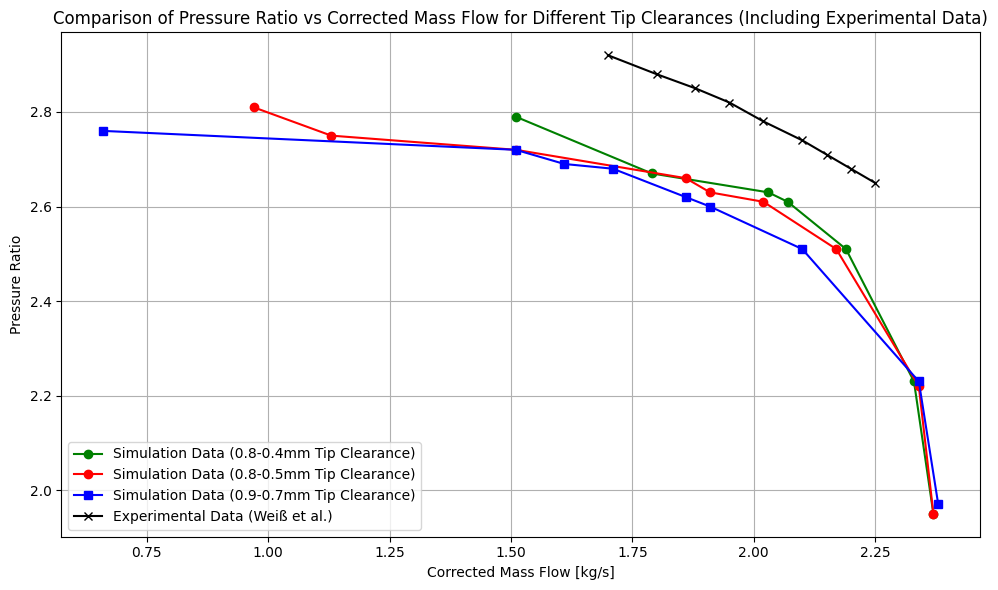
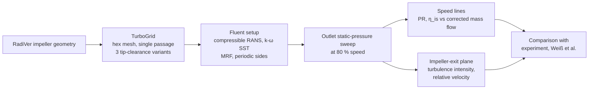
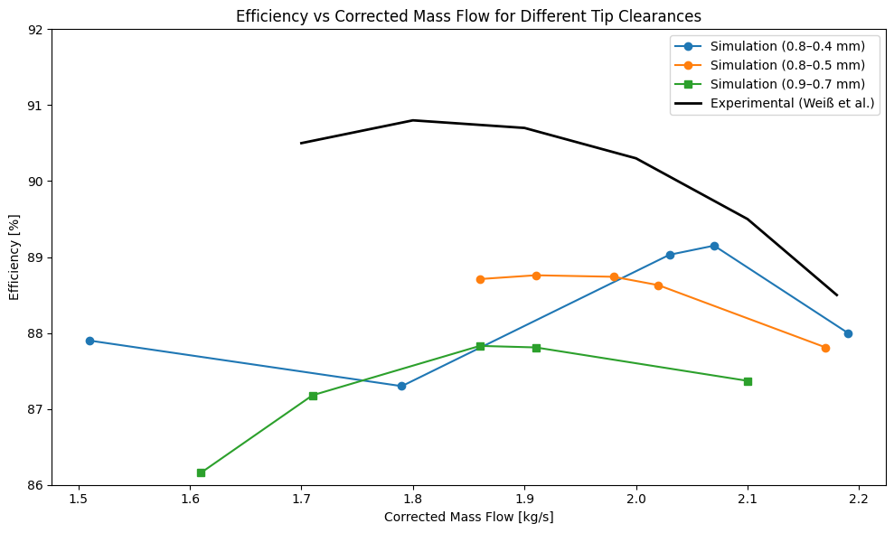
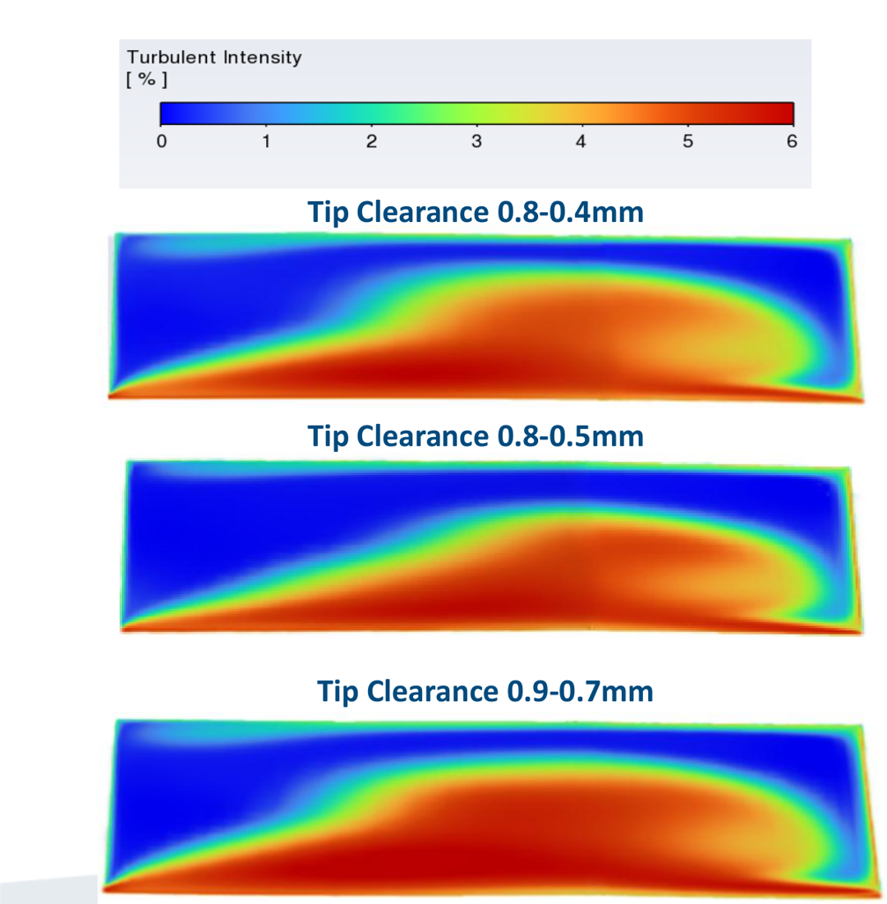
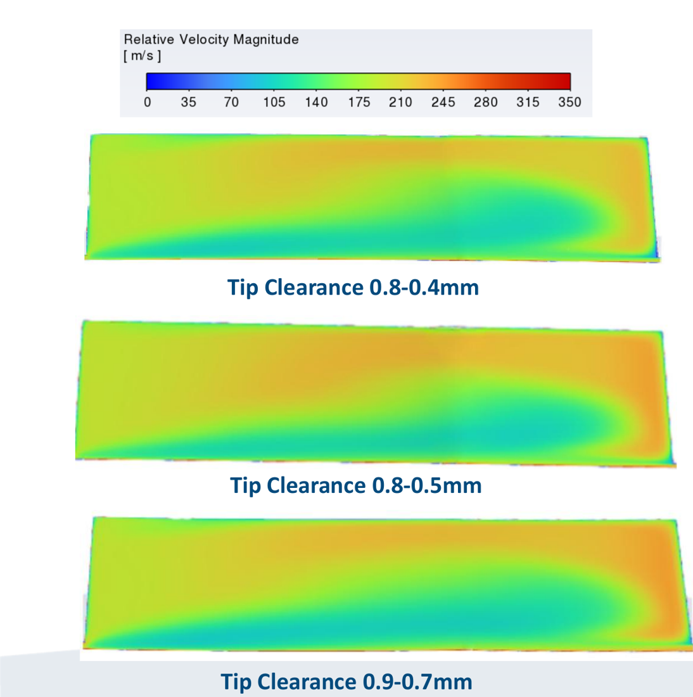

# CFD Validation Study of the RadiVer Centrifugal Compressor

**Steady compressible RANS · ANSYS TurboGrid + Fluent · single-passage MRF model · effect of tip clearance on pressure ratio, efficiency and impeller-exit wake at 80 % design speed**

Applied CFD project, TU Bergakademie Freiberg (Oct 2025 – Mar 2026) · **Krishna Kumar Ramamurthi**

[📈 Results](#results) · [⚙️ Numerical setup](#numerical-setup) · [⚠️ Limitations](#scope-and-limitations)


*Total pressure ratio versus corrected mass flow at 80 % design speed for three tip-clearance configurations, compared with the experimental characteristic (Weiß et al.).*

## Project at a glance

| | |
|---|---|
| **Problem** | The tip clearance between impeller blade tips and casing drives tip-leakage flow, a primary loss source in transonic centrifugal compressors. |
| **What was done** | A single-passage CFD model of the RadiVer benchmark compressor was built and run over full speed lines for three linearly varying tip-clearance gaps. |
| **Engineering** | Structured hexahedral meshing (TurboGrid), compressible RANS with k–ω SST in a rotating reference frame (Fluent), outlet-pressure sweeps, compressor-map post-processing, wake analysis at the impeller exit |
| **Result** | The measured pressure-ratio trend and the impeller-exit jet–wake structure were reproduced; larger clearance reduced pressure ratio and efficiency. Absolute pressure ratio and efficiency were under-predicted relative to the experiment. |
| **Evidence** | Compressor maps and impeller-exit contours (this repository), final presentation |

## Workflow



## Numerical setup

| Item | Configuration |
|---|---|
| Test case | RadiVer transonic centrifugal compressor (benchmark with published experimental data) |
| Operating point | 80 % design speed (transonic regime) |
| Domain | Inlet duct, impeller passage (rotating), outlet region; single blade passage with periodic side faces |
| Mesh | Hexahedral structured mesh, ANSYS TurboGrid, refinement in the tip gap; quality (skewness, orthogonality) checked in Fluent |
| Tip clearance | Linearly varying gap from leading to trailing edge: **0.8–0.4 mm, 0.8–0.5 mm, 0.9–0.7 mm** (experimental reference: 0.7–0.48 mm) |
| Physics | Steady, compressible ideal gas, viscous; rotating reference frame (MRF) for the impeller |
| Turbulence | k–ω SST |
| Solver | Pressure-based, coupled pressure–velocity scheme |
| Discretisation | Pressure second order; momentum, energy and turbulence second-order upwind |
| Boundary conditions | Pressure inlet (total pressure 60 kPa, total temperature 300 K); pressure outlet (static pressure varied); no-slip adiabatic walls; no blade deformation |
| Evaluated quantities | Total pressure ratio, isentropic efficiency, corrected mass flow; turbulence intensity and relative velocity at the impeller exit |

Validation criterion: agreement with experimental performance and flow trends. A formal grid-convergence study was not part of this project.

## Results

### Pressure ratio

- Pressure ratio falls with increasing corrected mass flow for all three clearances, following the shape of the measured characteristic.
- The largest clearance (0.9–0.7 mm) gives the lowest pressure ratio over most of the speed line; the two smaller clearances lie close together, with 0.8–0.4 mm generally highest.
- Over the compared mass-flow range, all simulated speed lines lie **below** the measured characteristic. The simulated clearances do not reproduce the experimental gap (0.7–0.48 mm) exactly; the steady single-passage model is a further simplification.

### Isentropic efficiency



- The largest clearance (0.9–0.7 mm) gives the lowest efficiency over most of its operating range.
- The smallest clearance (0.8–0.4 mm) reaches the highest simulated efficiency (about 89 %, read from the plot) near 2.05–2.1 kg/s. Below about 2.0 kg/s its efficiency falls below the 0.8–0.5 mm case, so the expected clearance ranking is only clear in the upper mass-flow range.
- Simulated efficiencies lie roughly 1.5–3 percentage points below the measured curve (read from the plot), and the simulated efficiency maximum is shifted to higher mass flow than the measured one.

### Impeller-exit wake

| Turbulence intensity | Relative velocity |
|---|---|
|  |  |

- The jet–wake pattern typical of centrifugal impeller exits is reproduced, with the wake at a consistent location for all clearances.
- The high-turbulence region is largest for the 0.9–0.7 mm clearance, consistent with stronger leakage-induced mixing and the lower efficiency of that case.

## Key findings

1. Increasing tip clearance increases leakage-driven mixing and wake strength and reduces pressure ratio and efficiency.
2. The model reproduces the measured trends and the jet–wake structure qualitatively.
3. Quantitatively, the model under-predicts pressure ratio and efficiency; closer agreement would require matching the experimental clearance and testing the modelling assumptions below.

## Scope and limitations

- Steady, single-passage MRF model: no rotor–stator interaction, no unsteady effects.
- No formal grid-convergence study; mesh quality was checked, but discretisation uncertainty was not quantified.
- Simulated tip clearances differ from the experimental reference clearance.
- Adiabatic walls and rigid blades.
- One speed line (80 % design speed) only.

## My contribution

- Structured meshing of three tip-clearance variants in ANSYS TurboGrid
- Fluent setup (compressible RANS, k–ω SST, MRF, periodic boundaries) and outlet-pressure sweeps
- Post-processing of compressor maps and impeller-exit flow fields
- Comparison with the experimental reference data and final presentation

## Repository structure

```
docs/images/   compressor maps and impeller-exit contours
results/       post-processed operating-point data (CSV)
```

## Reference data

Experimental comparison data: Weiß et al. (RadiVer test case). Full reference: **[add full bibliographic reference]**.

## License

© Krishna Kumar Ramamurthi. Figures and text are provided for reference. Experimental data shown in the plots belong to their original authors.
